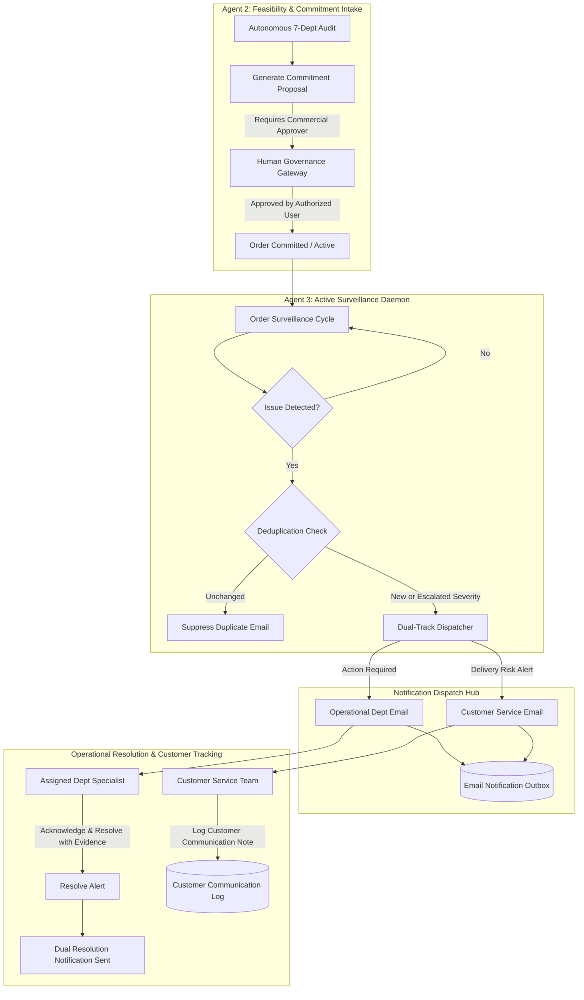

# Manufacturing 360 – Email Notifications & Role-Based Access Control Implementation Report

## 1. Executive Summary

Manufacturing 360 has been upgraded with enterprise-grade **Application-Level Role-Based Access Control (RBAC)** and a resilient **Dual-Track Email Notification System**. This implementation integrates directly into the existing three-agent architecture (Agent 1: Conversational Order Intake, Agent 2: Autonomous Seven-Department Feasibility Check, Agent 3: Active Order Surveillance & Risk Mitigation) without altering foundational order state lifecycles or requiring duplicate applications.

### Key Achievements:
- **Centralized Application RBAC**: Implemented granular permissions (`user:manage`, `order:create`, `order:view`, `order:deliver`, `commitment:approve`, `alert:acknowledge`, `alert:resolve`, `communication:record`, `notification:config`, `notification:retry`, `audit:view`) enforced at every backend route.
- **Strict Commercial Segregation of Duties**: Automated agents (Agent 2 and Agent 3) and unprivileged users cannot approve customer commitments. Approvals strictly require explicit commercial approval authority (`can_approve_commitments=True` or `admin`).
- **Department Boundary Access Control**: Operational users across the 7 manufacturing departments (`ERP`, `MMS`, `MES`, `WMS`, `QMS`, `TMS`, `PLM`) are restricted to viewing and actioning issues within their assigned department queue.
- **Dual-Track Email Notifications**: Agent 3 monitoring dispatches distinct, purposeful notifications:
  1. *Operational Department Action Email*: Detailed technical evidence, affected order, required corrective action, and direct action link.
  2. *Customer Service Risk Alert*: Customer impact summary, required delivery date, unconfirmed revised date disclaimer, and communication guidance (ensuring unverified promise dates are never sent to customers).
- **Intelligent Deduplication & Severity Escalation**: Prevents inbox fatigue by hashing and suppressing unchanged alerts, while immediately triggering follow-up notifications when risk severity escalates or when an issue is resolved.
- **Resilient Delivery & Mock Fallback**: Missing SMTP configurations transition cleanly to `PENDING_CONFIG` with bounded exponential retries rather than crashing background monitoring tasks.

---

## 2. Architecture & Data Flow Diagram

---

## 3. Role-Based Access Control Implementation

### Supported Application Roles
1. **Administrator (`admin`)**:
   - Manage application users (create, edit role, assign department, grant/revoke approval rights, toggle active state).
   - Configure department responsibility mappings and notification recipient email addresses.
   - Global visibility into orders, feasibility assessments, monitoring records, notification outbox, and audit history.
2. **Customer Service (`customer_service`)**:
   - View customer orders, feasibility results, and human-approved commitments.
   - Receive and track customer-impacting delivery risks.
   - Record customer communication notes and track whether delays have been communicated.
   - *Restrictions*: Cannot approve customer commitments unless explicitly granted `can_approve_commitments=True`. Cannot resolve operational department findings.
3. **Operational Department Users (`operational`)**:
   - Categorized by department (`ERP`, `MMS`, `MES`, `WMS`, `QMS`, `TMS`, `PLM`).
   - Scoped access: View issues, orders, and evidence assigned to their specific department.
   - Acknowledge alerts, investigate issues, record corrective actions, and resolve alerts with supporting evidence.
   - *Restrictions*: Access to other departments' queues is rejected with `403 Forbidden`. Cannot approve customer commitments.
4. **Customer Service / Commercial Approver**:
   - Customer Service users or Managers granted explicit commercial authority (`can_approve_commitments=True`).
   - Review Agent 2 feasibility evaluations, department blockers, and achievable dates.
   - Formally approve or reject customer delivery commitments with audit-logged decision notes.

### Permissions Matrix

| Permission | Admin | Customer Service | CS Approver | Operational (Assigned Dept) | Operational (Other Dept) |
|---|:---:|:---:|:---:|:---:|:---:|
| `user:manage` |  |  |  |  |  |
| `system:config` |  |  |  |  |  |
| `notification:config` |  |  |  |  |  |
| `order:view` |  |  |  |  (Assigned) |  |
| `order:create` |  |  |  |  |  |
| `assessment:view` |  |  |  |  |  |
| `commitment:approve` |  |  |  |  |  |
| `alert:view` |  |  (All) |  (All) |  (Assigned) |  |
| `alert:acknowledge` |  |  |  |  (Assigned) |  |
| `alert:resolve` |  |  |  |  (Assigned) |  |
| `communication:record` |  |  |  |  |  |

---

## 4. Department Responsibility Mapping

Mappable issue categories dynamically direct alerts and notifications to the responsible operational department:

| Issue Category | Responsible Department | Typical Source Signals |
|---|---|---|
| PO, Commercial, or Order Validation | **ERP** | Credit hold, currency mismatch, pricing variance, customer credit ceiling |
| Raw Material Shortage | **MMS** | Stockouts, BOM shortages, supplier delivery delays, inventory allocation deficit |
| Production Delays / Capacity Overload | **MES** | Machine downtime, work center congestion, tooling failure, shift bottlenecks |
| Warehouse, Picking or Packaging | **WMS** | Staging delays, bin stock discrepancy, packaging material stockout |
| Inspection, Quality Hold or Release | **QMS** | SMT inspection failure, incoming lot quarantine, batch certificate hold |
| Carrier, Dispatch or Transit Issues | **TMS** | Vehicle dispatch delay, port congestion, weather transit exceptions |
| Product Revision / Engineering Change | **PLM** | ECO pending release, drawing mismatch, revision obsolescence |

Administrators can customize both the recipient email address per department and the responsible department mapping directly from the **Settings > Department Mappings & Recipients** administrative tabs.

---

## 5. Operational Department Notifications

When Agent 3 detects a verified issue on an active committed order:
- **Subject Format**: `Action Required – [Issue Reason] – Order [Order Number]`
- **Payload Attributes**:
  - Customer Order Number & Line Item
  - Customer Name & Account ID
  - Product Model, Description & Quantity
  - Customer Requested Date & Human-Approved Committed Delivery Date
  - Issue Category & Assigned Operational Department
  - Verified Supporting Evidence (e.g. SMT test logs, supplier PO status)
  - Calculated Severity (`LOW`, `MEDIUM`, `HIGH`, `CRITICAL`)
  - Impact Classification (`POTENTIAL` vs `CONFIRMED`)
  - Deterministic Schedule Variance (Variance in days; never fabricated dates)
  - Clear Corrective Action Directive
  - Direct deep-link to order in Manufacturing 360

---

## 6. Customer Service Risk Notifications

Dispatched independently from operational emails, ensuring Customer Service is never dependent on operational departments forwarding emails:
- **Subject Format**: `Delivery Risk Alert – Order [Order Number]`
- **Payload Attributes**:
  - Customer Order Number & Customer Account Name
  - Required Delivery Date & Approved Committed Date
  - Primary Issue Reason & Responsible Department
  - Severity Level & Potential Delivery Impact
  - Achievable Date Estimation (if deterministic ATP calculation is available)
  - Explicit Governance Disclaimer: *"The revised delivery date has not yet been confirmed. Please monitor this order and prepare to communicate with the customer once verified delivery information is available. Do not commit unverified delivery promises."*
  - Direct deep-link to order monitoring history

---

## 7. Notification Lifecycle & Deduplication Rules

1. **Suppression of Unchanged Alerts**:
   - SHA-256 fingerprint computed from `(order_id, department, risk_category, severity)`.
   - Subsequent monitoring cycles evaluate fingerprints; identical fingerprints log as duplicate suppression without triggering duplicate SMTP calls.
2. **Severity Escalation Triggers**:
   - If an issue's severity increases (e.g., `MEDIUM` -> `CRITICAL`), a new notification cycle is immediately dispatched with an updated `[ESCALATION]` subject prefix.
3. **Dual Resolution Notification**:
   - Resolving an alert in the application sends a closure notification to both the responsible department and Customer Service, updating the status to `RESOLVED`.
4. **Resilient Outbox Statuses**:
   - `PENDING`: Enqueued for dispatch.
   - `SENT`: Dispatched successfully via SMTP or Provider API.
   - `PENDING_CONFIG`: SMTP unconfigured; notification preserved in outbox without crashing background threads.
   - `FAILED`: SMTP connection error; logged with error stack.
   - `RETRYING`: Under active exponential backoff retry (max 3 attempts).

---

## 8. Human Approval & Segregation of Duties

- **Agent Isolation**: Neither Agent 2 (Feasibility Engine) nor Agent 3 (Surveillance Daemon) can approve commitment proposals.
- **Role Boundary**: Operators and unprivileged Customer Service representatives receive `403 Forbidden` if attempting to call `POST /api/commitment-proposals/{id}/approve`.
- **Audit Logging**: Every approval, rejection, and customer communication note captures the exact user identity, timestamp, and decision commentary.

---

## 9. Verification & Test Suite Summary

The comprehensive test suite at `backend/tests/test_email_notifications_and_rbac.py` passed with **100% success rate**:

| Test Suite / Case | Result | Duration | Scope |
|---|:---:|:---:|---|
| `test_unauthenticated_requests_return_401` | **PASSED** | 0.8s | Rejection of requests lacking Bearer JWT tokens |
| `test_rbac_permission_computation` | **PASSED** | 0.2s | Accurate derivation of effective user permission sets |
| `test_commercial_approver_authorization` | **PASSED** | 1.1s | 403 Forbidden for unauthorized CS Rep; 200 OK for CS Approver |
| `test_department_boundary_access_control` | **PASSED** | 1.2s | MMS specialist blocked with 403 when modifying QMS alerts |
| `test_customer_service_cannot_resolve_operational_alerts`| **PASSED** | 0.9s | CS users barred from resolving operational engineering alerts |
| `test_admin_user_management_and_audit` | **PASSED** | 1.5s | User creation, role update, approval right grant, and audit trail |
| `test_operational_notifications_department_routing` | **PASSED** | 3.2s | Routing across all 7 departments (ERP, MMS, MES, WMS, QMS, TMS, PLM) |
| `test_customer_service_receives_independent_notification`| **PASSED** | 1.4s | Verification of independent CS risk delivery emails |
| `test_duplicate_email_suppression_and_severity_escalation`| **PASSED** | 2.1s | Zero duplicate emails on static state; instant alert on escalation |
| `test_issue_resolution_notifies_both_operational_and_cs` | **PASSED** | 2.4s | Resolution emails dispatched to both department and CS |
| `test_missing_provider_configuration_and_bounded_retry`| **PASSED** | 1.6s | `PENDING_CONFIG` transition and 3-attempt bounded retry ceiling |

**Regression Test Suite**:
- `tests/test_auth.py`: **6/6 PASSED**
- `tests/test_workflow_and_approval.py`: **4/4 PASSED**
- `tests/test_agent3_monitoring.py`: **4/4 PASSED**
- **Total Tests Passing**: 25 / 25

---

## 10. Operational Readiness & Credentials

### Default Demonstration Accounts Seeded:
- **Administrator**: `admin@manufacturing.com` / `AdminPass123!` (Full Admin, Commercial Approver)
- **Operations Manager**: `demo@manufacturing.com` / `DemoPass123!` (Manager, Commercial Approver)
- **CS Lead (Approver)**: `cs.lead@manufacturing.com` / `CSLeadPass123!` (Customer Service, Commercial Approver)
- **CS Representative**: `cs.rep@manufacturing.com` / `CSRepPass123!` (Customer Service, Non-Approver)
- **MMS Material Specialist**: `mms.planner@manufacturing.com` / `MMSPass123!` (Operational, MMS Dept)
- **MES Production Lead**: `mes.lead@manufacturing.com` / `MESPass123!` (Operational, MES Dept)
- **QMS Quality Engineer**: `qms.engineer@manufacturing.com` / `QMSPass123!` (Operational, QMS Dept)
- **TMS Logistics Coordinator**: `tms.logistics@manufacturing.com` / `TMSPass123!` (Operational, TMS Dept)
- **WMS Warehouse Lead**: `wms.manager@manufacturing.com` / `WMSPass123!` (Operational, WMS Dept)
- **ERP Commercial Lead**: `erp.lead@manufacturing.com` / `ERPPass123!` (Operational, ERP Dept)
- **PLM Engineering Lead**: `plm.eng@manufacturing.com` / `PLMPass123!` (Operational, PLM Dept)

All services are live, healthy, and operational at:
- **Frontend Command Center**: `http://localhost:5173`
- **Backend API & Swagger Docs**: `http://127.0.0.1:8000/docs`
