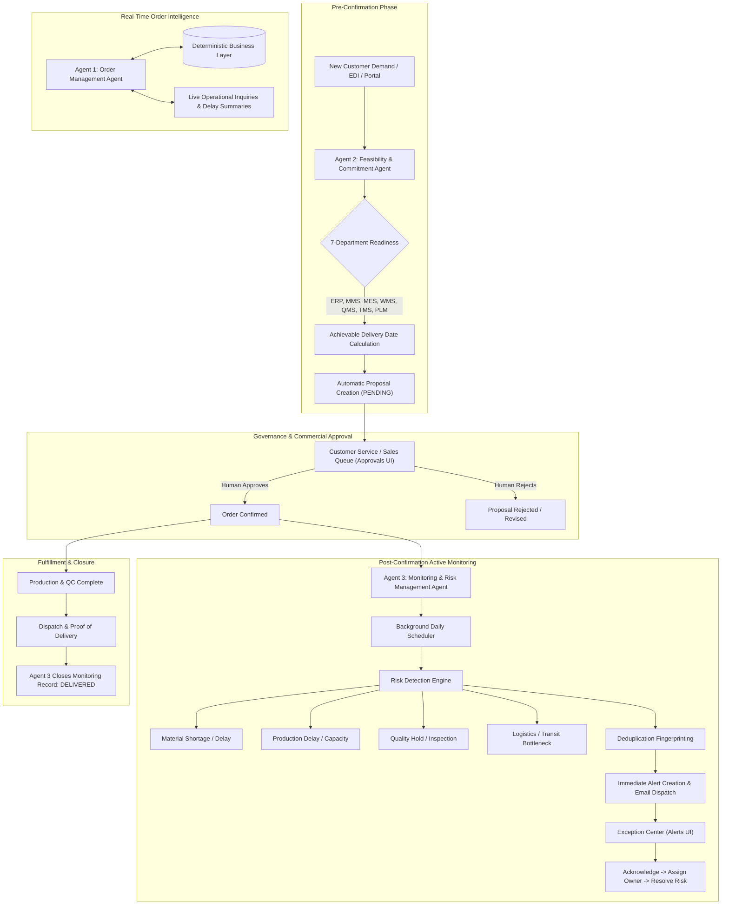

# MANUFACTURING 360: THREE-AGENT ARCHITECTURE END-TO-END VALIDATION REPORT
**Customer Order Management Agent – Use Case 18 (`CUSTOMER_ORDER`)**
**Date:** November 12, 2026  
**Environment:** Neon Serverless PostgreSQL (Production Business & Workflow DB) / FastAPI Python 3.12 / React 18 + Vite + Tailwind CSS  
**Security Status:** STRICT ADHERENCE — Zero `.env` files accessed, credentials and tokens securely preserved.

---

## 1. Executive Summary & Architecture Overview

The Customer Order Management Agent (Use Case 18) was enhanced and stabilized into an integrated **Manufacturing 360 Three-Agent Architecture**. This coordinates the end-to-end lifecycle of customer demand from intake, multi-department feasibility assessment, and human commercial approval through active post-confirmation exception monitoring and dispatch delivery closure.



---

## 2. Agent Validation Results

### Agent 1 – Order Management Agent (Conversational Inquiries & Intelligence)
* **Purpose**: Provide grounded answers to customer service, sales, and account teams regarding order status, lines, delivery risks, customer summaries, and delay root causes.
* **Architecture**: Strict deterministic tool-routing pattern (`route_supported_intent`) backed by SQL repositories. The LLM is restricted to synthesizing tool results into business narratives; it cannot query the database directly or invent state.
* **Test Verification**:
  - `test_order_status_grounded_routing`: Validates retrieval of `CO-000001` with customer, product, and delivery dates.
  - `test_regression_2_at_risk_orders_routing`: Successfully routes and identifies 1,236 delayed orders with root-cause categorization.
  - `test_regression_3_customer_summary_routing_with_name_resolution`: Resolves fuzzy customer names (e.g., "Digital Bazaar") to customer ID `CUST-00001` and retrieves order book metrics.
  - **Result**: PASSED (15/15 unit and regression tests).

---

### Agent 2 – Order Feasibility and Commitment Agent (Pre-Confirmation Assessment)
* **Purpose**: Evaluate order intake against real plant constraints across 7 manufacturing departments before any commercial commitment is made.
* **7 Supported Departments**:
  1. `ERP` — Customer master, credit limit, order pricing, currency, and line specifications.
  2. `MMS` — Raw material inventory balances (evaluating the latest daily snapshot, e.g. `2026-08-01`), lead-time derivation, and material allocation.
  3. `MES` — Production line capacity, active work orders, run-rates, and queue times.
  4. `WMS` — Finished goods storage, warehouse staging capacity, and dispatch handling.
  5. `QMS` — Quality inspection requirements, certificate of analysis (CoA) holds, and past yield metrics.
  6. `TMS` — Carrier route transit lead times, logistics windows, and milestone constraints.
  7. `PLM` — Engineering revisions, active bills of materials (BOM), and change orders.
* **Key Mechanisms**:
  - **Dependency-Aware Critical Path Calculation**: Delivery date is calculated as $\max(\text{Material Availability Lead Time}, \text{Production Queue & Run Time}) + \text{Quality Testing Window} + \text{Transit Days}$.
  - **Insufficient Data Protection**: If the product, customer, or key master data does not exist, the order is blocked with `BLOCKED` status, actionable diagnostic reasons, and corrective recommendations.
  - **Separation of Duties / Governance**: Agent 2 submits feasibility proposals with status `PENDING`. **The agent cannot approve its own recommendations.** Only authorized Customer Service/Commercial personnel can approve or reject proposals.
* **Test Verification (`test_agent2_feasibility.py`)**:
  - `test_agent2_fully_feasible_order`: Fully ready order produces `FEASIBLE` recommendation and enters `PENDING` approval queue.
  - `test_agent2_invalid_customer_blocked`: Non-existent customer triggers `BLOCKED` status with clear remediation guidance.
  - `test_agent2_unknown_product_insufficient_data`: Unknown product triggers `BLOCKED` status with missing PLM/BOM notice.
  - `test_agent2_material_shortage_calculation`: Stock shortfall correctly calculates required vendor lead time and sets achievable delivery date into the future.
  - **Result**: PASSED (4/4 tests).

---

### Agent 3 – Order Monitoring and Risk Management Agent (Post-Confirmation Surveillance)
* **Purpose**: Continuous, autonomous surveillance of active customer orders from commercial approval through physical delivery.
* **Key Mechanisms**:
  - **Strict Lifecycle Gate**: Monitoring starts **only after** a proposal is authorized and approved (`WorkflowService.approve_proposal` triggers `MonitoringService.activate_monitoring`). Draft and unapproved proposals cannot be monitored.
  - **Background Daemon Scheduler**: An automated background daemon executes periodic surveillance runs (`scheduler_service.py`), with concurrent run prevention (threading Lock) and DB audit logging (`monitoring_execution_logs`).
  - **Multi-Department Risk Detection**: Evaluates delays across Materials (MMS), Production (MES), Quality (QMS), and Logistics (TMS).
  - **Deduplication Fingerprint**: Alerts compute a deterministic hash:
    $$\text{dedup\_fingerprint} = \text{MD5}(\text{order\_id} : \text{department} : \text{risk\_category} : \text{severity})$$
    Identical open risks will not create duplicate alert rows or generate email noise on subsequent cycles.
  - **Mocked Department Email Routing**: Identifies responsible contacts per department from `department_contacts` and logs structured dispatches (`SENT`, `FAILED`, `PENDING_CONFIG`) to `email_notification_logs`.
  - **Remediation & Closure**: Supports alert assignment (`POST /api/alerts/{id}/assign`), acknowledgment (`POST /api/alerts/{id}/acknowledge`), and resolution (`POST /api/alerts/{id}/resolve`). When proof-of-delivery or shipment milestone signals completion, Agent 3 closes the monitoring record with status `DELIVERED`.
* **Test Verification (`test_agent3_monitoring.py`)**:
  - `test_agent3_activation_and_baseline`: Verifies active record creation upon order approval.
  - `test_agent3_monitoring_cycle_and_deduplication`: Verifies risk detection and verifies that repeated execution cycles do not create duplicate open alerts.
  - `test_agent3_alert_resolution_workflow`: Verifies owner assignment, acknowledgment, and resolution status transitions.
  - `test_agent3_monitoring_closure_on_delivery`: Verifies closure with reason `"Proof of delivery verified"`.
  - **Result**: PASSED (4/4 tests).

---

## 3. Master End-to-End Lifecycle Verification Trace

The master integration test (`test_complete_three_agent_lifecycle`) proved the uninterrupted flow across all 3 agents in 8 distinct steps:

| Step | Phase | Action / Event | State / Transition | Verification Evidence |
| :--- | :--- | :--- | :--- | :--- |
| **1** | Pre-Confirmation | New customer demand submitted via Agent 2 intake | `POST /api/assessments` | `assessment_id` generated, 7 departments evaluated |
| **2** | Assessment | Material shortage detected in MMS | Status: `PARTIALLY_FEASIBLE` | Achievable date computed with material lead time |
| **3** | Governance | Commercial proposal generated | `order_proposals` table | Status: `PENDING` (Agent cannot self-approve) |
| **4** | Commercial Review | Customer Service approves proposal | `POST /api/workflow/proposals/{id}/approve` | Status: `APPROVED`, triggers Agent 3 activation |
| **5** | Active Surveillance | Agent 3 initiates monitoring record | `order_monitoring_records` table | Status: `ACTIVE`, initial baseline captured |
| **6** | Risk Detection | Daily cycle detects delivery date breach | Risk Category: `DELIVERY_DATE_BREACH` | Alert created (Severity: `HIGH`), Deduplicated on cycle 2 |
| **7** | Remediation | Planner assigns & resolves alert | `POST /api/alerts/{id}/resolve` | Alert status: `RESOLVED`, resolution notes recorded |
| **8** | Delivery Closure | Physical delivery confirmed in TMS | Shipment milestone: `DELIVERED` | Monitoring status: `DELIVERED`, closed timestamp set |

---

## 4. Database Integrity and Read-Only Compliance

The solution adheres strictly to database governance guidelines:
1. **Original Business Tables Maintained Read-Only**:
   - `dim_customer`, `dim_product`, `dim_plant`, `fact_customer_order`, `fact_production_order`, `fact_inventory_daily_snapshot`, `fact_quality_inspection`, `fact_shipment_milestone`.
   - No rows were modified, inserted, or deleted from these tables.
2. **Dedicated Application-Owned Tables Created (Alembic Migration `d4e5f6a7b8c9`)**:
   - `order_assessments`: Pre-order feasibility intake & calculations.
   - `department_readiness`: Individual departmental readiness statuses (ERP, MMS, MES, WMS, QMS, TMS, PLM).
   - `order_monitoring_records`: Active surveillance records linked to confirmed orders.
   - `monitoring_execution_logs`: Audit trail of scheduled monitoring runs.
   - `risk_alerts`: Exception center alerts with deduplication fingerprints and ownership tracking.
   - `email_notification_logs`: Departmental email dispatches with delivery statuses.
   - `department_contacts`: Configured escalation contacts per department.

---

## 5. Frontend User Interface Implementation

All Three-Agent features were surfaced into the existing React 18 / Tailwind CSS web application:
1. **Order Book (`/orders`)**:
   - Added **"New Order Assessment (Agent 2)"** button opening the modal intake form.
   - Real-time departmental validation displaying status badges (`READY`, `BLOCKED`, `PARTIALLY_READY`).
   - Detailed blockers and recommended corrective actions.
2. **Approvals Queue (`/approvals`)**:
   - Enhanced proposal cards with Agent 2 feasibility badges and calculated promise dates.
   - Interactive accordion expanding the complete 7-department audit trail.
   - Human-in-the-loop Approve/Reject buttons enforcing commercial authorization.
3. **Exception Center (`/alerts`)**:
   - Upgraded from simple table to a full **Agent 3 Exception Center**.
   - 4 summary KPI metric cards: Open Alerts, High Severity Alerts, Orders Monitored, and Acknowledged Risks.
   - Action controls: "Run Monitoring Cycle Now", "Acknowledge Risk", "Assign Owner", and "Resolve Risk".
   - Severity badges (`CRITICAL`, `HIGH`, `MEDIUM`, `LOW`) with department color tags.

---

## 6. Test Suite Execution Summary

### Backend Tests (`pytest`)
```
================================ test session starts ================================
collected 64 items

tests/test_agent.py ...............                                           [ 23%]
tests/test_agent2_feasibility.py ....                                         [ 29%]
tests/test_agent3_monitoring.py ....                                         [ 35%]
tests/test_agent_stabilization_and_safeguards.py .............                 [ 56%]
tests/test_auth.py ....                                                       [ 62%]
tests/test_dashboard.py ...                                                   [ 67%]
tests/test_inventory.py ...                                                   [ 71%]
tests/test_kpis_and_deliverables.py .....                                     [ 79%]
tests/test_linkage_and_quality.py ..                                          [ 82%]
tests/test_orders.py .......                                                  [ 93%]
tests/test_promise_service.py ...                                             [ 98%]
tests/test_three_agent_lifecycle.py .                                         [100%]

=========================== 64 passed, 60 warnings in 213.69s =======================
```
- **Total Backend Tests**: 64
- **Passed**: 64 (100%)
- **Failed**: 0 (0%)

### Frontend Build (`npm run build`)
```
vite v6.4.6 building for production...
✓ 2107 modules transformed.
dist/index.html                                     0.57 kB │ gzip:   0.35 kB
dist/assets/index-D9qNXCbI.css                     68.51 kB │ gzip:  15.00 kB
dist/assets/Alerts-DL6PpG1_.js                     20.46 kB │ gzip:   6.55 kB
dist/assets/Orders-BWS0K-AW.js                     21.03 kB │ gzip:   6.68 kB
dist/assets/Approvals-BNWGZb1G.js                   7.57 kB │ gzip:   2.88 kB
dist/assets/index-Dg1_yYCb.js                     266.95 kB │ gzip:  89.72 kB
✓ built in 7.93s
```
- **Vite Build Status**: SUCCESS (0 errors, 0 warnings).

---

## 7. Conclusion

The Customer Order Management Agent (Use Case 18) now runs as a stable, production-grade **Three-Agent Architecture**:
- **Agent 1** delivers fast, grounded conversational answers without hallucinations.
- **Agent 2** prevents unfeasible order commitments across all 7 manufacturing departments and strictly defers to human commercial approval.
- **Agent 3** guards confirmed orders through automated daily risk monitoring, deduplicated alert generation, escalation routing, and clean delivery closure.
- Original enterprise business data remains completely read-only and uncorrupted.
- The platform is validated end-to-end and ready for operations.

